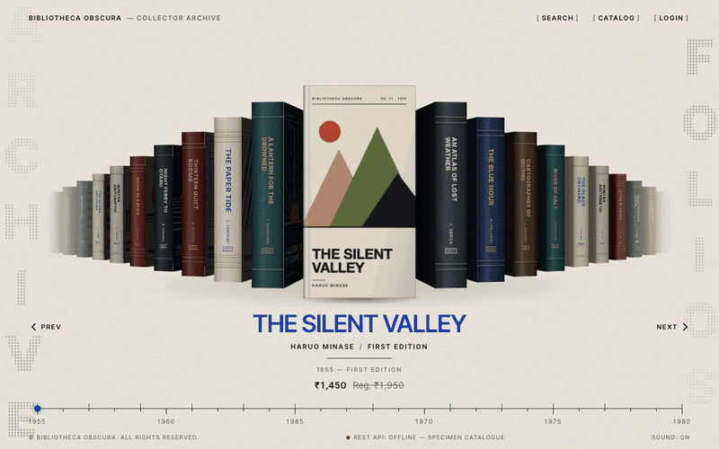
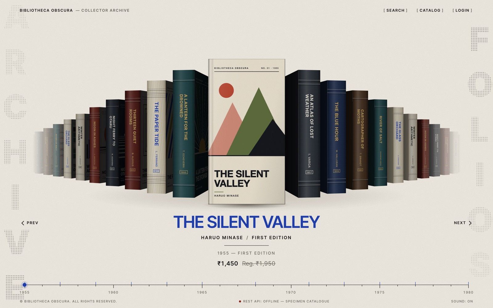
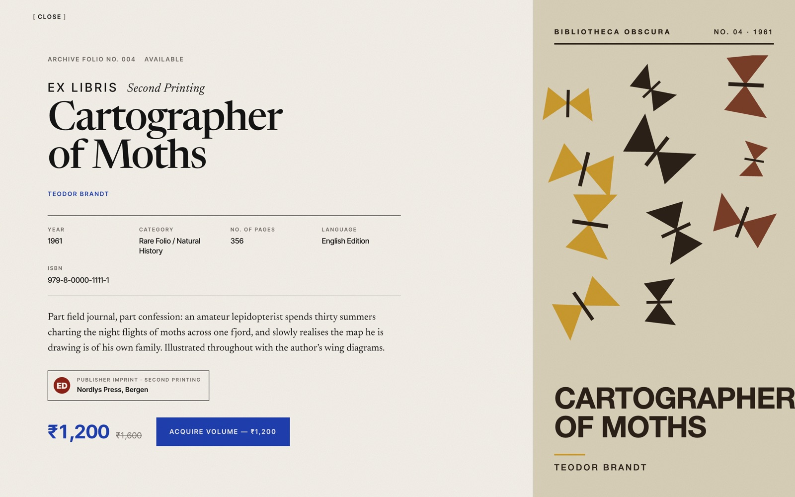
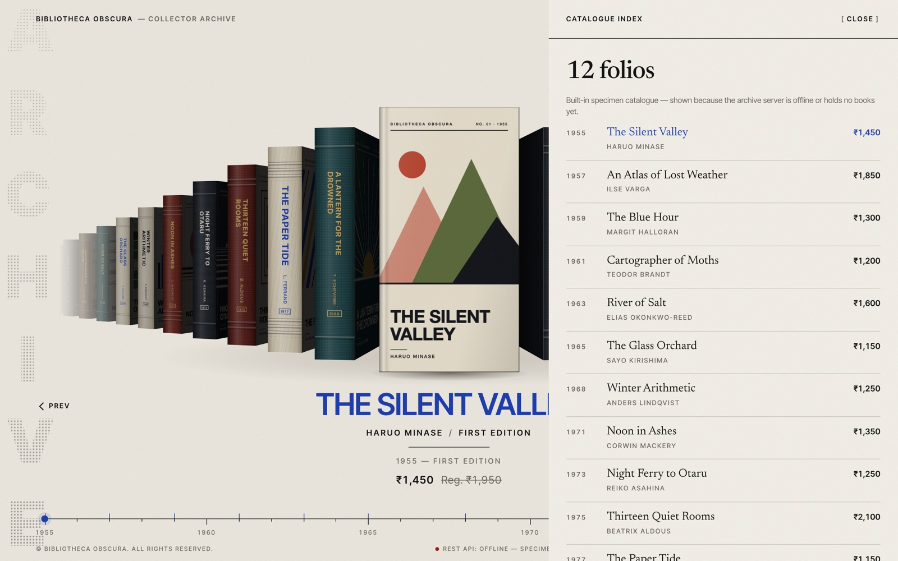
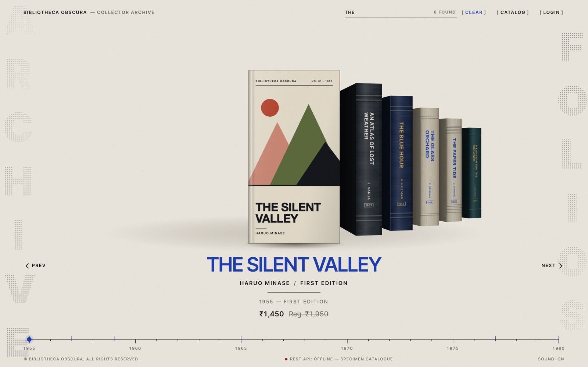
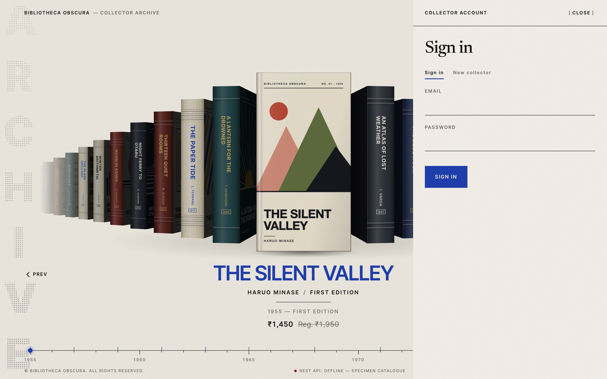
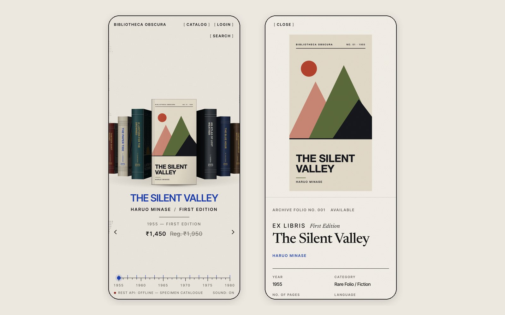
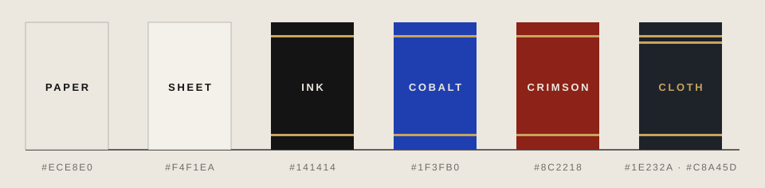

<div align="center">


# Bibliotheca Obscura

**— Collector Archive —**

A curved 3D bookshelf for rare and collectible folios.<br />
Scroll the spines, pull a volume off the shelf, and acquire it through Stripe.


<br />



</div>

---

## The shelf

Every volume stands on one arc. The active book turns to face you, its
neighbours recede into perspective, and the timeline beneath tracks where you
are in the collection. Spines and covers are drawn procedurally from cloth,
gold foil and band patterns, so a book with no artwork still looks bound.



| Input | Action |
| --- | --- |
| Scroll, drag, or <kbd>←</kbd> <kbd>→</kbd> | Turn the shelf, one volume per notch, with spring settling |
| Click the cover, or <kbd>Enter</kbd> | Open the folio |
| <kbd>Esc</kbd> | Return the folio to the shelf |
| `[ SEARCH ]` | Filter by title; the shelf sinks and re-spools around the matches |
| `SOUND: ON` | Toggle the Web Audio page-click and paper flutter |

## The folio

Opening a book blooms it into a full archival record: edition, category,
pages, language, ISBN, abstract, publisher imprint and price, with the cover
poster bleeding in on the right. Signed-in collectors acquire it through
Stripe Checkout.



## Around the archive

<table>
  <tr>
    <td width="50%" valign="top">
      
      <p align="center"><sub><b>CATALOGUE INDEX</b> · every folio by year, author and price</sub></p>
    </td>
    <td width="50%" valign="top">
      
      <p align="center"><sub><b>SEARCH</b> · the shelf re-spools to the matching volumes</sub></p>
    </td>
  </tr>
  <tr>
    <td width="50%" valign="top">
      
      <p align="center"><sub><b>COLLECTOR ACCOUNT</b> · sign in or register to acquire</sub></p>
    </td>
    <td width="50%" valign="top">
      
      <p align="center"><sub><b>ON A PHONE</b> · the same shelf, swipe to turn</sub></p>
    </td>
  </tr>
</table>

## Theme

An archival palette: paper and ink, one cobalt accent for whatever is in
focus, crimson for seals and status, and dark book-cloth with gold-foil bands.



| Element | In the app |
| --- | --- |
| **Type** | [Inter Tight](https://fonts.google.com/specimen/Inter+Tight) for labels, spines and the caption; [Newsreader](https://fonts.google.com/specimen/Newsreader) for titles and prose in the folio |
| **Labels** | Uppercase, widely tracked, bracketed as buttons: `[ CATALOG ]` |
| **Motion** | `cubic-bezier(0.2, 0.8, 0.2, 1)` springs for the shelf, `cubic-bezier(0.76, 0, 0.18, 1)` for the ink-bleed folio reveal; reduced-motion is respected |
| **Texture** | Paper grain over the whole page and dot-matrix `ARCHIVE` / `FOLIOS` lettering in the margins |

The tokens live in [`frontend/src/index.css`](frontend/src/index.css), and
[`FRONTEND_PROMPT.md`](FRONTEND_PROMPT.md) is the full design specification the
frontend was built from.

---

## Under the hood

| Folder | What it is |
| --- | --- |
| [`frontend/`](frontend/) | Vite, React 19, TypeScript and Tailwind CSS v4. A single `requestAnimationFrame` engine owns every shelf frame; React only handles the catalogue, overlays and auth. See [`frontend/README.md`](frontend/README.md) for the architecture. |
| [`backend/`](backend/) | Node.js, Express and MongoDB (Mongoose) REST API: books, collector accounts with JWT, image uploads via multer, and Stripe Checkout. |

<details>
<summary><b>API routes</b> (all under <code>/api</code>)</summary>

| Method | Route | Auth | Purpose |
| --- | --- | --- | --- |
| `POST` | `/register`, `/login`, `/google-login` | — | Collector accounts |
| `GET` | `/getHomeBooks`, `/getBooks`, `/viewBook/:id` | — | Catalogue |
| `POST` | `/addBook` | JWT | Add a book with up to 5 images |
| `PUT` | `/update-user` | JWT | Update profile |
| `PUT` | `/makePayment` | JWT | Start a Stripe Checkout session |
| `GET` | `/getUsers`, `/admin/getBooks`, `/getAdmin` | Admin | Admin views |
| `PUT` | `/update-admin` | Admin | Update admin profile |

Uploaded images are served from `/uploads`.

</details>

## Run it

Requires Node.js 20+ and a MongoDB instance (local or Atlas).

```bash
npm run install:all                      # installs backend and frontend dependencies
cp backend/.env.example backend/.env     # then set MONGODB_URI, JWT_KEY and paymentKey
npm run dev                              # backend on :3000 and frontend on :5173 (macOS / Linux)
```

Or run them separately, in two terminals:

```bash
npm run dev:backend    # http://localhost:3000
npm run dev:frontend   # http://localhost:5173
```

The frontend proxies `/api` and `/uploads` to the backend. **No backend yet?**
Run only the frontend: the shelf falls back to twelve built-in specimen folios
(the ones in the screenshots above), which you can browse but not buy.

Other scripts: `npm run build` and `npm run lint` (both for the frontend).
